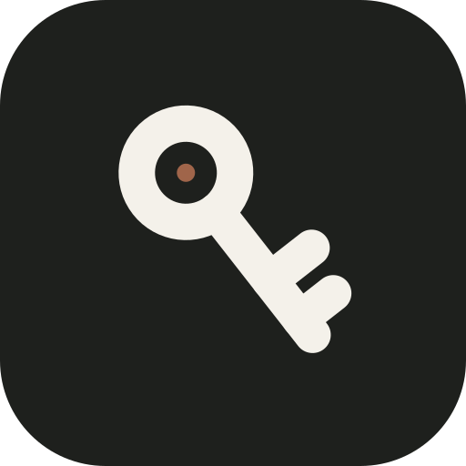
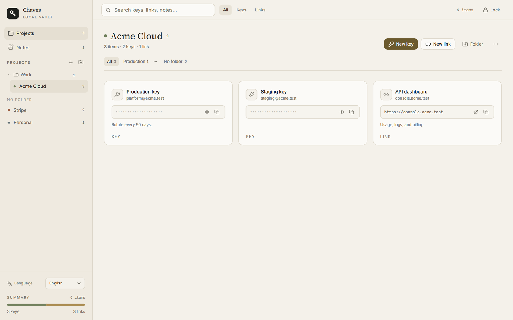

<div align="center">
  
  <h1>Chaves</h1>
  <p><strong>Your API keys, links, and notes. Local, encrypted, and quiet.</strong></p>
  <p>No account. No cloud. No telemetry.</p>
</div>

<p align="center">
  <a href="https://github.com/ricarossetto/chaves/releases/latest"></a>
  <a href="LICENSE"></a>
  
  
</p>

<p align="center">
  <a href="README.pt-BR.md">Português</a> · <a href="README.zh-CN.md">中文</a>
</p>

---

Chaves is a small desktop vault for the credentials you use every day. Keep API keys and important links inside projects and folders, write quick notes, and unlock everything with one master password.

It is built for people who want a local tool, not another subscription: the vault is a single encrypted file on your computer, and the app never talks to a server.

## Why Chaves

API keys usually end up scattered across notes apps, spreadsheets, `.env` files, and browser bookmarks. Chaves gives them one quiet place:

- **Keys and links together.** Store an API key with its account, notes, and project. Store a link with the same context.
- **Projects, not a flat list.** Group credentials by client, service, or environment. Nested folders keep larger vaults tidy.
- **Search that stays out of the way.** Press the search field and filter across every project by name, account, URL, or note.
- **Notes for the details that do not fit.** Runbooks, renewal dates, and reminders live next to the credentials.
- **A real desktop app.** Native window, tray icon, keyboard-friendly forms, and no browser tab to lose.

## Features

- AES-256-GCM encrypted vault with an Argon2id-derived key.
- Projects, project folders, item folders, and fast filtering.
- API keys with masked values, reveal, copy, and account labels.
- Links with host preview, open, and copy actions.
- Markdown-free notes with debounced autosave.
- Optional Windows Hello unlock (Windows only). The master password is protected with Windows DPAPI and never leaves the machine.
- Lock from the app or the tray. Closing the window can keep Chaves running in the background.
- Portuguese, English, and Chinese interface, with the choice saved locally.
- Import of older Chaves vaults.
- No account, no sync, no analytics, no network requests.

## Screenshot



## Install

Pick the package for your platform from the [latest release](https://github.com/ricarossetto/chaves/releases/latest).

| Platform | Package |
| --- | --- |
| Windows 10/11 x64 | `Chaves_*_x64-setup.exe` |
| Windows 11 ARM64 | `Chaves_*_arm64-setup.exe` |
| macOS Apple Silicon | `Chaves_*_aarch64.dmg` |
| macOS Intel | `Chaves_*_x64.dmg` |
| Linux x64 | `.AppImage` or `.deb` |

### Windows

1. Download the installer for your architecture.
2. Run it and open Chaves.

The current builds are not code-signed. Windows SmartScreen may show a warning; choose **More info** → **Run anyway** if you trust the build.

The release also includes a portable `chaves-api-windows-*.exe`. It needs the Microsoft Edge WebView2 runtime, which is already present on Windows 10 and 11. The installer is the recommended option because it registers the app in the Start menu and handles upgrades.

### macOS

1. Download the DMG for your Mac: Apple Silicon (`aarch64`) or Intel (`x64`).
2. Open the DMG and drag Chaves to Applications.

The macOS builds are unsigned and not notarized. On first launch, right-click Chaves in Finder and choose **Open**. If macOS still blocks it, remove the quarantine flag:

```bash
sudo xattr -dr com.apple.quarantine /Applications/Chaves.app
```

### Linux

**AppImage:**

```bash
chmod +x Chaves_*.AppImage
./Chaves_*.AppImage
```

**Debian/Ubuntu:**

```bash
sudo apt install ./chaves_*.deb
```

The AppImage needs WebKitGTK 4.1 and the Ayatana app indicator. On Debian/Ubuntu:

```bash
sudo apt install libwebkit2gtk-4.1-0 libayatana-appindicator3-1
```

### First run

1. Create a master password with at least 8 characters. It cannot be recovered, so store it in a password manager.
2. On Windows, optionally enable Windows Hello on this PC.
3. Create a project and add your first key or link.

## Security model

- The entire vault is serialized and encrypted with **AES-256-GCM**.
- The encryption key is derived from the master password with **Argon2id** using 64 MiB of memory, 3 iterations, and 1 lane.
- Every save uses a fresh 12-byte nonce. The 16-byte salt is stored in the vault envelope.
- The master password is never written to disk.
- Windows Hello is optional. When enabled, the master password is encrypted with the current Windows user's **DPAPI** and stored in `hello.bin` next to the vault. Windows Hello verifies presence; the cryptographic protection still comes from Windows.
- Chaves makes no network requests. Fonts and assets are bundled with the app.

Chaves protects a vault file at rest. It does not protect against a compromised computer, malware, keyloggers, or someone who already controls your system session.

## Where data lives

| Platform | Default vault |
| --- | --- |
| Windows | `%APPDATA%\ChavesAPI\vault.json` |
| macOS | `~/Library/Application Support/Chaves/vault.json` |
| Linux | `$XDG_DATA_HOME/chaves/vault.json` or `~/.local/share/chaves/vault.json` |

The Windows Hello file, when enabled, sits next to the vault on Windows as `hello.bin`. Windows Hello is not offered on macOS or Linux.

To use another location, set the `CHAVES_VAULT_PATH` environment variable to the full path of the vault file before opening the app. Back up `vault.json` and `hello.bin` together if you use Windows Hello.

## Build from source

### Requirements

- Node.js 20 or newer
- Rust stable
- **Windows:** Visual Studio Build Tools with the Desktop development with C++ workload, and the WebView2 runtime
- **macOS:** Xcode Command Line Tools
- **Linux:** `libwebkit2gtk-4.1-dev`, `libayatana-appindicator3-dev`, `librsvg2-dev`, `patchelf`, and `libfuse2`

On Debian/Ubuntu:

```bash
sudo apt install libwebkit2gtk-4.1-dev libayatana-appindicator3-dev librsvg2-dev patchelf libfuse2
```

### Build

```bash
git clone https://github.com/ricarossetto/chaves.git
cd chaves
npm install
npx tauri build
```

The output is written to `src-tauri/target/release/bundle/`. To choose a bundle explicitly:

```bash
npx tauri build --bundles nsis        # Windows
npx tauri build --bundles dmg         # macOS
npx tauri build --bundles deb,appimage # Linux
```

For UI work only:

```bash
npm install
npm run dev
```

The Vite server runs on `http://localhost:1420`.

## Stack

- [Tauri 2](https://tauri.app/) and Rust for the vault, Windows Hello, and the tray.
- [React 19](https://react.dev/), TypeScript, Vite, Tailwind CSS v4.
- [shadcn/ui](https://ui.shadcn.com/) primitives and beUI components (MIT).
- Source Serif 4 for headings, Inter for the interface, IBM Plex Mono for keys and URLs.

## Contributing

Issues and pull requests are welcome. Before opening a PR:

1. Keep the change focused and explain the user-facing behavior.
2. Run `npm run build` and `cargo test --manifest-path src-tauri/Cargo.toml`.
3. Never commit a real vault, `hello.bin`, API keys, or personal paths.

## License

MIT. See [LICENSE](LICENSE).
