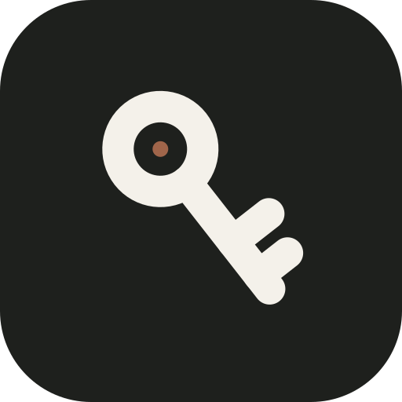
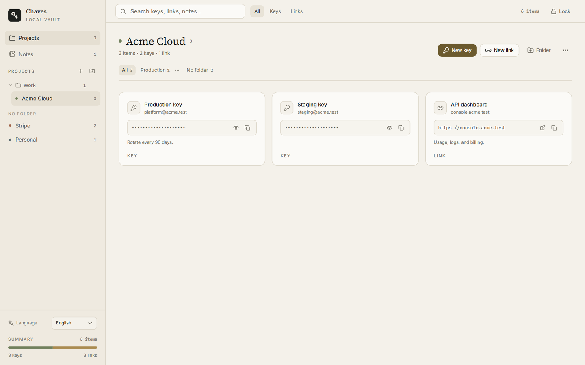

<div align="center">
  
  <h1>Chaves</h1>
  <p><strong>Suas chaves de API, links e anotações. Locais, criptografados e discretos.</strong></p>
  <p>Sem conta. Sem nuvem. Sem telemetria.</p>
</div>

<p align="center">
  <a href="https://github.com/ricarossetto/chaves/releases/latest"></a>
  <a href="LICENSE"></a>
  
  
</p>

<p align="center">
  <a href="README.md">English</a> · <a href="README.zh-CN.md">中文</a>
</p>

---

O Chaves é um cofre de mesa pequeno para as credenciais que você usa todos os dias. Guarde chaves de API e links importantes dentro de projetos e pastas, escreva anotações rápidas e destrave tudo com uma única senha mestra.

Ele foi feito para quem quer uma ferramenta local, não mais uma assinatura: o cofre é um único arquivo criptografado no seu computador, e o aplicativo nunca conversa com um servidor.

## Por que o Chaves

Chaves de API costumam acabar espalhadas entre aplicativos de notas, planilhas, arquivos `.env` e favoritos do navegador. O Chaves dá a elas um lugar tranquilo:

- **Chaves e links juntos.** Guarde uma chave de API com a conta, as observações e o projeto. Guarde um link com o mesmo contexto.
- **Projetos, não uma lista solta.** Agrupe credenciais por cliente, serviço ou ambiente. Pastas dentro dos projetos mantêm cofres maiores organizados.
- **Busca sem atrapalhar.** Use o campo de busca e filtre todos os projetos por nome, conta, URL ou observação.
- **Anotações para o que não cabe na chave.** Procedimentos, datas de renovação e lembretes ficam ao lado das credenciais.
- **Um aplicativo de verdade.** Janela nativa, ícone na bandeja, formulários que funcionam pelo teclado e nenhuma aba do navegador para perder.

## Recursos

- Cofre criptografado com AES-256-GCM e chave derivada por Argon2id.
- Projetos, pastas de projetos, pastas de itens e filtros rápidos.
- Chaves de API com valor mascarado, revelar, copiar e identificação da conta.
- Links com prévia do domínio, abrir e copiar.
- Anotações com salvamento automático e debounce.
- Desbloqueio opcional com Windows Hello (somente no Windows). A senha mestra é protegida pelo DPAPI do Windows e nunca sai do computador.
- Bloquear pelo aplicativo ou pela bandeja. Ao fechar a janela, o Chaves pode continuar em segundo plano.
- Interface em português, inglês e chinês, com a escolha salva localmente.
- Importação automática de cofres antigos do Chaves.
- Sem conta, sem sincronização, sem análise de uso e sem requisições de rede.

## Captura de tela



## Instalação

Escolha o pacote da sua plataforma na [última versão](https://github.com/ricarossetto/chaves/releases/latest).

| Plataforma | Pacote |
| --- | --- |
| Windows 10/11 x64 | `Chaves_*_x64-setup.exe` |
| Windows 11 ARM64 | `Chaves_*_arm64-setup.exe` |
| macOS Apple Silicon | `Chaves_*_aarch64.dmg` |
| macOS Intel | `Chaves_*_x64.dmg` |
| Linux x64 | `.AppImage` ou `.deb` |

### Windows

1. Baixe o instalador da sua arquitetura.
2. Execute o instalador e abra o Chaves.

As compilações atuais não têm assinatura de código. O Windows SmartScreen pode mostrar um aviso; escolha **Mais informações** → **Executar assim mesmo** se confiar na compilação.

A versão também inclui um executável portátil `chaves-api-windows-*.exe`. Ele precisa do Microsoft Edge WebView2, que já vem no Windows 10 e 11. O instalador é a opção recomendada porque registra o aplicativo no menu Iniciar e cuida das atualizações.

### macOS

1. Baixe o DMG da sua máquina: Apple Silicon (`aarch64`) ou Intel (`x64`).
2. Abra o DMG e arraste o Chaves para Aplicativos.

As compilações do macOS não são assinadas nem notarizadas. Na primeira execução, clique com o botão direito no Chaves e escolha **Abrir**. Se o macOS continuar bloqueando, remova a quarentena:

```bash
sudo xattr -dr com.apple.quarantine /Applications/Chaves.app
```

### Linux

**AppImage:**

```bash
chmod +x Chaves_*.AppImage
./Chaves_*.AppImage
```

**Debian/Ubuntu:**

```bash
sudo apt install ./chaves_*.deb
```

O AppImage precisa do WebKitGTK 4.1 e do indicador Ayatana. No Debian/Ubuntu:

```bash
sudo apt install libwebkit2gtk-4.1-0 libayatana-appindicator3-1
```

### Primeira execução

1. Crie uma senha mestra com pelo menos 8 caracteres. Ela não pode ser recuperada, então guarde-a em um gerenciador de senhas.
2. No Windows, se quiser, ative o Windows Hello neste computador.
3. Crie um projeto e adicione sua primeira chave ou link.

## Modelo de segurança

- O cofre inteiro é serializado e criptografado com **AES-256-GCM**.
- A chave de criptografia é derivada da senha mestra com **Argon2id**, usando 64 MiB de memória, 3 iterações e 1 faixa.
- Cada gravação usa um nonce novo de 12 bytes. O salt de 16 bytes fica guardado no envelope do cofre.
- A senha mestra nunca é gravada em disco.
- O Windows Hello é opcional. Quando ativado, a senha mestra é criptografada com o **DPAPI** do usuário atual do Windows e guardada em `hello.bin`, ao lado do cofre. O Windows Hello confirma a presença; a proteção criptográfica continua sendo a do Windows.
- O Chaves não faz requisições de rede. Fontes e recursos são empacotados com o aplicativo.

O Chaves protege o arquivo do cofre em repouso. Ele não protege contra um computador comprometido, malware, capturadores de teclado ou alguém que já controla a sua sessão do sistema.

## Onde ficam os dados

| Plataforma | Cofre padrão |
| --- | --- |
| Windows | `%APPDATA%\ChavesAPI\vault.json` |
| macOS | `~/Library/Application Support/Chaves/vault.json` |
| Linux | `$XDG_DATA_HOME/chaves/vault.json` ou `~/.local/share/chaves/vault.json` |

O arquivo do Windows Hello, quando ativado, fica ao lado do cofre no Windows como `hello.bin`. O Windows Hello não é oferecido no macOS nem no Linux.

Para usar outro local, defina a variável de ambiente `CHAVES_VAULT_PATH` com o caminho completo do arquivo do cofre antes de abrir o aplicativo. Faça backup de `vault.json` e `hello.bin` juntos se usar o Windows Hello.

## Compilar do código-fonte

### Requisitos

- Node.js 20 ou mais recente
- Rust stable
- **Windows:** Visual Studio Build Tools com a carga de trabalho Desenvolvimento para desktop com C++, e o runtime do WebView2
- **macOS:** Xcode Command Line Tools
- **Linux:** `libwebkit2gtk-4.1-dev`, `libayatana-appindicator3-dev`, `librsvg2-dev`, `patchelf` e `libfuse2`

No Debian/Ubuntu:

```bash
sudo apt install libwebkit2gtk-4.1-dev libayatana-appindicator3-dev librsvg2-dev patchelf libfuse2
```

### Compilar

```bash
git clone https://github.com/ricarossetto/chaves.git
cd chaves
npm install
npx tauri build
```

O resultado é gravado em `src-tauri/target/release/bundle/`. Para escolher um pacote explicitamente:

```bash
npx tauri build --bundles nsis        # Windows
npx tauri build --bundles dmg         # macOS
npx tauri build --bundles deb,appimage # Linux
```

Para trabalhar apenas na interface:

```bash
npm install
npm run dev
```

O servidor do Vite roda em `http://localhost:1420`.

## Stack

- [Tauri 2](https://tauri.app/) e Rust para o cofre, o Windows Hello e a bandeja.
- [React 19](https://react.dev/), TypeScript, Vite e Tailwind CSS v4.
- Primitivas do [shadcn/ui](https://ui.shadcn.com/) e componentes do beUI (MIT).
- Source Serif 4 nos títulos, Inter na interface e IBM Plex Mono em chaves e URLs.

## Contribuindo

Problemas e pull requests são bem-vindos. Antes de abrir um PR:

1. Mantenha a mudança focada e explique o comportamento visível para o usuário.
2. Rode `npm run build` e `cargo test --manifest-path src-tauri/Cargo.toml`.
3. Nunca envie um cofre real, `hello.bin`, chaves de API ou caminhos pessoais.

## Licença

MIT. Veja [LICENSE](LICENSE).
