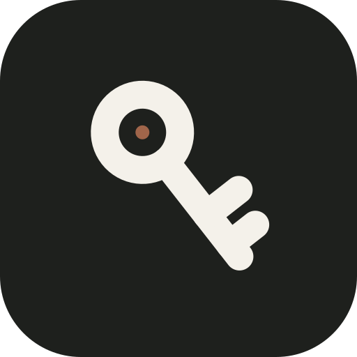
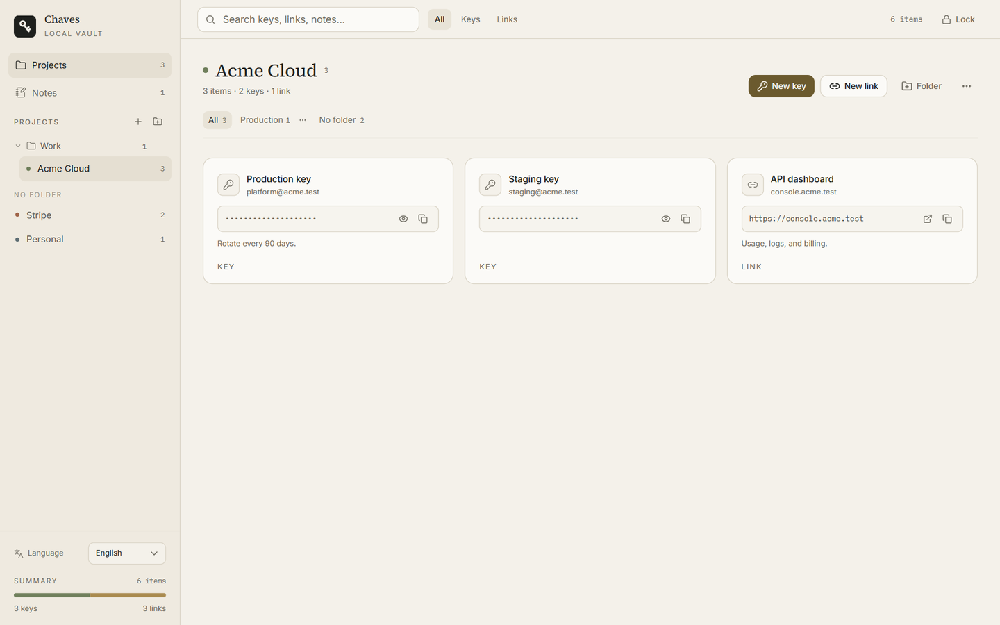

<div align="center">
  
  <h1>Chaves</h1>
  <p><strong>你的 API 密钥、链接和笔记。本地、加密、安静。</strong></p>
  <p>无需账户。无需云端。无遥测。</p>
</div>

<p align="center">
  <a href="https://github.com/ricarossetto/chaves/releases/latest"></a>
  <a href="LICENSE"></a>
  
  
</p>

<p align="center">
  <a href="README.md">English</a> · <a href="README.pt-BR.md">Português</a>
</p>

---

Chaves 是一个小巧的桌面保险库，用来存放你每天都会用到的凭据。把 API 密钥和重要链接放进项目和文件夹，随手写笔记，用一个主密码解锁全部内容。

它面向想要本地工具、而不是又一份订阅的人：保险库是你电脑上的一个加密文件，应用从不与服务器通信。

## 为什么选择 Chaves

API 密钥常常散落在笔记应用、电子表格、`.env` 文件和浏览器书签里。Chaves 给它们一个安静的去处：

- **密钥和链接放在一起。** 保存 API 密钥时附带账号、笔记和项目；链接也保留同样的上下文。
- **按项目组织，而不是一张平铺列表。** 按客户、服务或环境分组。项目内的文件夹让大型保险库保持整洁。
- **不打扰的搜索。** 在搜索框中按名称、账号、URL 或笔记筛选所有项目。
- **放不下细节，就写笔记。** 操作步骤、续期日期和提醒与凭据放在一起。
- **真正的桌面应用。** 原生窗口、托盘图标、键盘友好的表单，没有会丢的浏览器标签页。

## 功能

- 使用 AES-256-GCM 加密保险库，密钥由 Argon2id 派生。
- 项目、项目文件夹、条目文件夹和快速筛选。
- API 密钥支持隐藏、显示、复制和账号标签。
- 链接支持域名预览、打开和复制。
- 笔记自动保存，带防抖。
- 可选的 Windows Hello 解锁。主密码由 Windows DPAPI 保护，永不离开本机。
- 可从应用或托盘锁定。关闭窗口时可让 Chaves 继续在后台运行。
- 葡萄牙语、英语和中文界面，选择会保存在本地。
- 自动导入旧版 Chaves 保险库。
- 无账户、无同步、无分析、无网络请求。

## 截图



## 安装

### 安装程序

1. 打开[最新版本](https://github.com/ricarossetto/chaves/releases/latest)。
2. 下载 `Chaves_*_x64-setup.exe`。
3. 运行安装程序并打开 Chaves。

当前构建未进行代码签名。Windows SmartScreen 可能显示警告；如果你信任该构建，请选择 **更多信息** → **仍要运行**。

### 便携版

发布页还包含独立可执行文件 `chaves-api.exe`。它需要 Microsoft Edge WebView2 运行时，Windows 10 和 11 已自带。推荐使用安装程序，因为它会在开始菜单注册应用并处理升级。

### 首次运行

1. 创建至少 8 个字符的主密码。主密码无法恢复，请保存在密码管理器中。
2. 可选：在此电脑上启用 Windows Hello。
3. 创建项目并添加第一个密钥或链接。

## 安全模型

- 整个保险库会序列化并使用 **AES-256-GCM** 加密。
- 加密密钥通过 **Argon2id** 从主密码派生，使用 64 MiB 内存、3 次迭代和 1 条通道。
- 每次保存都会使用新的 12 字节 nonce。16 字节 salt 存储在保险库信封中。
- 主密码从不写入磁盘。
- Windows Hello 是可选的。启用后，主密码会使用当前 Windows 用户的 **DPAPI** 加密，并保存在保险库旁边的 `hello.bin` 中。Windows Hello 确认用户在场；加密保护仍由 Windows 提供。
- Chaves 不发起网络请求。字体和资源都随应用打包。

Chaves 保护静态保险库文件。它无法防御已被入侵的电脑、恶意软件、键盘记录器，或已经控制你 Windows 会话的人。

## 数据位置

默认：

```text
%APPDATA%\ChavesAPI\vault.json
```

启用 Windows Hello 时，`hello.bin` 会放在同一目录。

要使用其他位置，请在打开应用前将环境变量 `CHAVES_VAULT_PATH` 设置为保险库文件的完整路径。如果使用 Windows Hello，请同时备份 `vault.json` 和 `hello.bin`。

## 从源码构建

### 要求

- Windows 10 或 11
- Node.js 20 或更高版本
- Rust stable
- 安装了“使用 C++ 的桌面开发”工作负载的 Visual Studio 生成工具
- WebView2 运行时

### 构建

```bash
git clone https://github.com/ricarossetto/chaves.git
cd chaves
npm install
npx tauri build
```

安装程序输出到 `src-tauri/target/release/bundle/nsis/`。只开发界面时：

```bash
npm install
npm run dev
```

Vite 服务器运行在 `http://localhost:1420`。

## 技术栈

- [Tauri 2](https://tauri.app/) 和 Rust 负责保险库、Windows Hello 和托盘。
- [React 19](https://react.dev/)、TypeScript、Vite、Tailwind CSS v4。
- [shadcn/ui](https://ui.shadcn.com/) 原语和 beUI 组件（MIT）。
- 标题使用 Source Serif 4，界面使用 Inter，密钥和 URL 使用 IBM Plex Mono。

## 参与贡献

欢迎提交 issue 和 pull request。提交 PR 前：

1. 保持改动聚焦，并说明用户可见的行为。
2. 运行 `npm run build` 和 `cargo test --manifest-path src-tauri/Cargo.toml`。
3. 永远不要提交真实保险库、`hello.bin`、API 密钥或个人路径。

## 许可证

MIT。参见 [LICENSE](LICENSE)。
